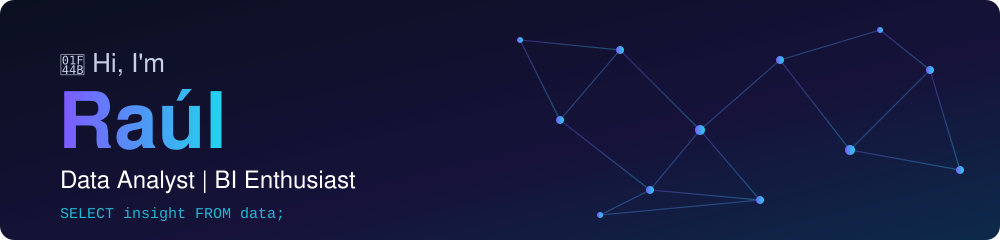

  

  💻 Specializing in <b>databases</b> and <b>data analysis</b> to build efficient, data-driven solutions. 
  📊 Passionate about turning data into actionable insights through <b>Data Analytics</b>, <b>Big Data</b>, <b>Business Intelligence</b> and <b>Artificial Intelligence</b>.

  <i>"Data tells a story. You just need to know how to read it."</i>

---

## ▌About Me

▸ Constantly seeking practical and efficient solutions in both code and workflow. 
▸ Eager to collaborate on data-driven and tech innovation projects. 
▸ Enthusiastic about clean code, agile methodologies and automation. 
▸ Interested in Data Analytics, Business Intelligence and Data Engineering. 
▸ Currently expanding my skills in data visualization, automation and cloud technologies.

---

## ▌Areas of Interest

`Data Analysis` · `Business Intelligence` · `Data Visualization` · `Database Design` · `Artificial Intelligence` · `Process Automation`

---

## ▌Tech Stack

**Languages**

  
  
  
  
  

**Data & BI**

  
  

**Databases**

  
  
  
  

**Tools & Platforms**

  
  
  
  
  

---

## ▌Current Focus

▸ Using **Python** for data analysis and automation. 
▸ Working with databases and data management. 
▸ Learning advanced Data Analytics and Business Intelligence. 
▸ Building projects that combine data analysis and automation.

---

## ▌Connect with Me

  
  

---

  <b>Always open to learning, collaborating and contributing to innovative projects.</b>

  <b>"Data tells a story. You just need to know how to read it."</b>

